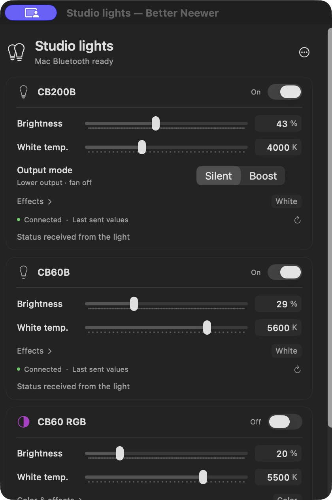

# Better Neewer

A small native macOS menu-bar controller for NEEWER studio lights. Power, brightness and white temperature stay together, with color and effects one click away.

[Download the public beta](https://github.com/mathewharwich/better-neewer/releases) · [Report an issue](https://github.com/mathewharwich/better-neewer/issues)



*The original three-light interface during studio use. The public beta adds discovery and saved profiles instead of embedding the author's devices.*

## Supported lights

| Model | Controls |
| --- | --- |
| CB60B | Power, brightness, 2700–6500 K, 12 effects |
| CB60 RGB | Power, brightness, 2700–6500 K, tint, HSI color, 17 effects |
| CB200B | Power, brightness, 2700–6500 K, 12 effects, Silent/Boost |

Better Neewer uses the Mac's Bluetooth directly. No NEEWER USB dongle, account or cloud service is required. It runs in the menu bar without a Dock icon; closing its controls keeps it running. Quit leaves each light's output unchanged.

This is an independent, MIT-licensed project, unaffiliated with NEEWER. Support is limited to the model profiles above. CB200B Boost is enabled only on firmware **1.1.5**, where switching and status readback were qualified.

## Install

Download and unzip the macOS beta, then move **Better Neewer.app** into Applications. The release is a universal Intel/Apple-silicon binary for macOS 14 or later.

The first public beta is Developer ID signed but **not notarized**. macOS may require the app-specific **Open Anyway** control in System Settings → Privacy & Security. Follow [Apple's instructions](https://support.apple.com/en-us/102445) for software from an identified developer. Do not disable Gatekeeper globally. You can also build locally from source.

## Add your lights

1. Open the app and allow Bluetooth access when macOS asks.
2. Click the menu-bar lightbulb and choose **Add lights**.
3. Supply mains power to your light and enable its Bluetooth/App mode. Choose the discovered fixture and **Add & connect**.
4. Use the basic controls, or expand Color & effects / Effects. Right-click its name to rename, refresh, disconnect or remove the local profile.

The app supports zero or many saved fixtures, including multiple units of the same model. Setup resolves the hardware address from local macOS Bluetooth metadata. If the full Bluetooth name is ambiguous or no address is reported, controls stay disabled. You can add one identical fixture at a time or supply a known address through the optional field. A matching live status reply is required before setting output; an unresolved address is never guessed.

A model name is not a unique device identity. The app saves each fixture's CoreBluetooth UUID and address locally. Enrollment on additional fixtures and firmware versions is still beta functionality.

## State and behavior

- Power and Boost display hardware-reported state; pending changes are shown separately.
- Brightness, temperature and color can be defaults, remembered values or last-sent requests. They are labeled as reported only when a validated full reply supplies those values. A successful Bluetooth write is not presented as measured output.
- Connecting, refreshing, reconnecting and opening controls never replay output settings.
- Brightness preserves the selected White/Color/Effect mode. Changing White temperature selects White.
- Slider updates are throttled and saves are debounced. Manual disconnections are preserved on wake.
- Profiles and settings stay in `~/Library/Application Support/Better Neewer/profiles-v2.json`. The app does not edit NEEWER's application or data. It reads local Bluetooth metadata during address resolution and does not send it to a service.

## Qualification and limits

Basic control was physically checked on CB60B, CB60 RGB and CB200B. Those checks covered power on all three, brightness/temperature on both bi-color lights, RGB color and Hue loop, and CB200B Boost. Menu-bar open/dismiss and no-Dock behavior were confirmed on an Intel Mac.

All 12/17 effects have source-backed encodings and offline tests; every scene, optional parameter combination, tint range and firmware has not been physically qualified. Generic discovery is newer than the original personal build. Apple-silicon execution, sleep/wake and Bluetooth off/on need broader field testing. A universal binary is not a claim of testing on both architectures. Radio range has not been benchmarked against the vendor dongle.

Firmware updates, vendor account services, Wi-Fi control, proprietary USB/2.4 GHz control and generic enrollment of other models are not included.

## Build and test

Install Xcode 16 or later, or its matching command-line tools, then run from the repository root:

```sh
./app/test.sh
./app/build.sh
```

The build creates `app/build/Better Neewer.app` with both `arm64` and `x86_64` slices. It uses only system Swift/AppKit/SwiftUI/Combine/CoreBluetooth frameworks. No packages are downloaded. Local builds are ad-hoc signed and require no Apple developer account.

Optional build settings:

```sh
BETTER_NEEWER_ARCHS=x86_64 ./app/build.sh
BETTER_NEEWER_SIGN_IDENTITY='Developer ID Application: Your Name (TEAMID)' ./app/build.sh
```

An explicit Developer ID build uses hardened runtime and a secure timestamp. Signing credentials are never part of the repository. The executable accepts `--control-window` for an optional standalone control window.

The offline suites cover wire fixtures, checksums/fragmentation, model bounds, all effect encodings, foreign replies, ambiguous address resolution, repeated model profiles, rename/removal and saved-setting validation. They do not scan for or control hardware.

## Contributing

See [CONTRIBUTING.md](CONTRIBUTING.md). Please include the model, firmware and what you observed, and sanitize any traces before posting. Protocol references and credits are in [ACKNOWLEDGMENTS.md](ACKNOWLEDGMENTS.md).

Copyright © 2026 Mathew Harwich. [MIT License](LICENSE).
